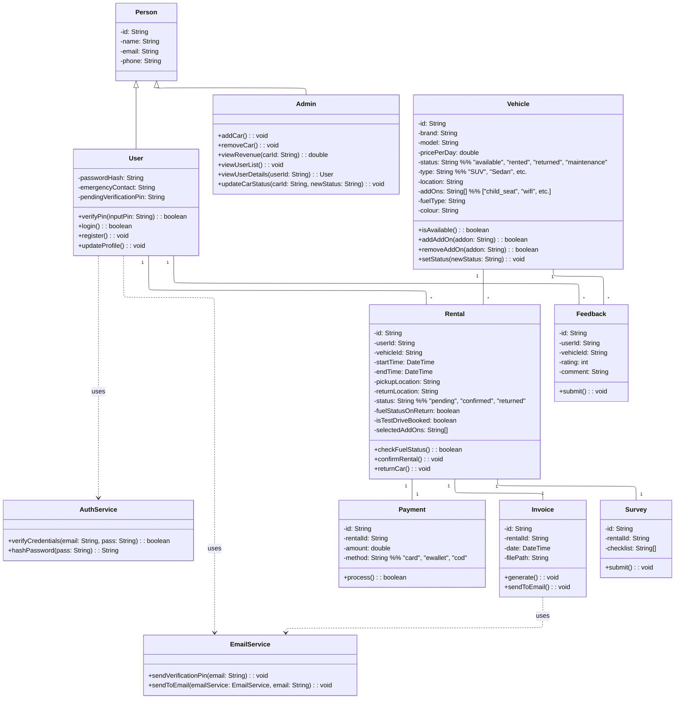

# BMCS2023 OOP Assignment
A Java-based Car Rental Application with a graphical user interface (GUI), cloud database integration, and email communication features. This system supports both Admin and User roles, offering full vehicle rental management and user interaction functionalities.

## 📌 Technologies Used

- **Language**: Java
- **Build Tool**: Gradle
- **Database**: Supabase (Cloud-based PostgreSQL)
- **UI Framework**: FlatLaf (Java Look and Feel)
- **Email Service**: JavaMail (SMTP integration)
- **Version Control**: Git + GitHub

## 📚 Features Overview

### 👤 User

- **Browse Vehicles**: View car price, type, and status without login.
- **Authentication**: Login or register with email verification (PIN code).
- **Vehicle Rental**:
  - Select rental and return date/time
  - Choose pickup and return location
  - Select add-on services (baby seat, delivery, etc.)
  - Multiple payment methods: Cash, Credit Card, E-wallet
- **Invoice Management**:
  - Receive confirmation and invoice via email
  - View rental history and receipts
- **Pre-drive Inspection**:
  - Conduct a vehicle survey before driving
- **Vehicle Return**:
  - Return to original location
  - Refuel confirmation prompt
  - Submit rating and feedback

### 🛠️ Admin

- **Admin Dashboard**:
  - Login with credentials
  - Access car and user management modules
- **Car Management**:
  - Add, update, and remove cars
  - View car details and rental history
  - Manage add-ons and vehicle status (e.g. Available, Rented, Maintenance)
  - Hide cars under maintenance from user view
  - View total revenue per car
  - Access customer ratings and feedback
- **User Management**:
  - View user list and individual profiles
  - Access emergency contact info
  - Assist during critical or emergency cases

## 🧭 Program Flow

### 1. Splash Screen → Main Menu
- Users can view available cars.
- Click on a car to view more details or begin rental process.
- Top-right button for login/profile.

### 2. Login / Register
- **Register**: Fill in personal and emergency contact info. Email PIN verification.
- **Login**: Authenticate with username and password.
- Post-login, users are redirected to main menu.

### 3. Car Rental Process
- Choose date/time and add-ons
- View price summary
- Select payment method
- Receive invoice via email
- Booking is saved in user history

### 4. Pickup and Survey
- Users get pickup address
- Fill in pre-drive condition form
- Confirmation to start driving

### 5. Return and Feedback
- Return to pickup location
- Prompt to refuel car
- Submit feedback and rating

### 6. Admin Dashboard
- Buttons: `Manage Cars`, `Manage Users`, `Logout`
- Each leads to detailed management interfaces

## 📝 Notes

- All vehicle add-ons and statuses are hardcoded into the program.
- GUI designed using FlatLaf for modern and polished look.
- JavaMail handles email services like invoice and account verification.
- Supabase handles user data, car info, rental history and payment records.

## Class Diagram

